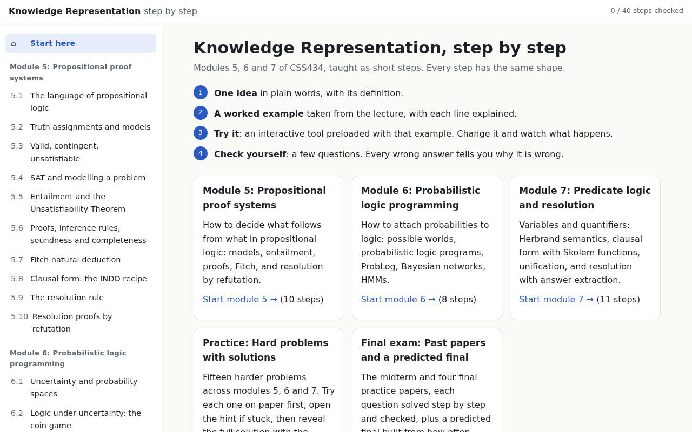

# Knowledge Representation Final Reader

Interactive reader for the Knowledge Representation final: modules 5 to 7 (propositional logic, SAT, Fitch, INDO and resolution; probabilistic logic and ProbLog; predicate logic, Herbrand semantics, unification and resolution with answer extraction), with step-by-step lessons, live widgets, worked examples from the Stanford Introduction to Logic book, a glossary, practice problems and past exams.

**Live site: https://toonzzzrock.github.io/knowledge-representation/**



## Run locally

No build and no dependencies. Open `index.html` directly from disk, or serve the folder:

```
python3 -m http.server 4173      # then http://localhost:4173
```

## Deploy

`.github/workflows/pages.yml` publishes the repo root to GitHub Pages on every push to `main`. In the repo settings, set Pages to deploy from GitHub Actions.
